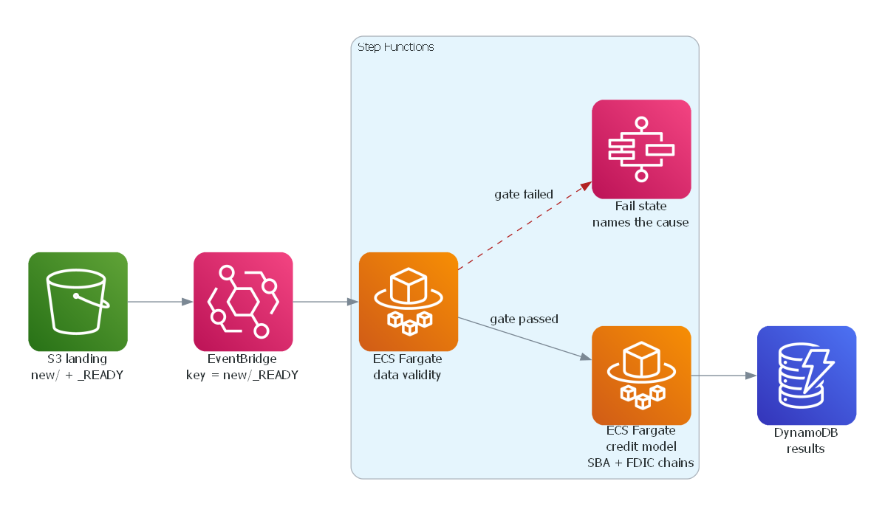
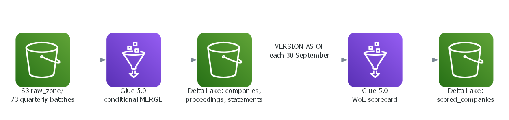
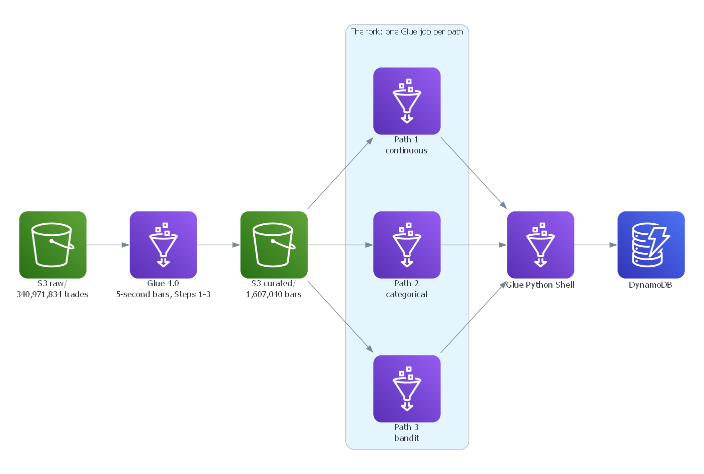

# Finance Projects

**Quantitative developer building credit-risk, fixed-income and market-data systems, from
statistical models to cloud pipelines on AWS and Azure.**

Seven of the projects are end-to-end AWS data pipelines, one is an Azure port of one of them, and
one is a notebook analysis of South African bank stocks. Every pipeline runs end to end on a laptop
with no AWS account, from a sample committed beside it.

## Featured projects

### SBA small-business credit risk — [`sba-credit-risk-ecs-dynamo`](sba-credit-risk-ecs-dynamo/)

PD, gross charge-off severity, expected loss, IFRS 9 stage and IRB capital for the 281,077 open
loans among 1,639,728 SBA 7(a) small-business loans, with bank-failure PD from every FDIC failure
since 1984 beside it. Two ECS Fargate containers, gated by Step Functions, write the results to
DynamoDB.

| Measure | Result |
| --- | --- |
| SBA scorecard, holdout AUC: FY2000-09 / the next vintage, FY2010 | 0.623 / 0.601 |
| Open book: 12-month and lifetime expected loss on $165.06bn of exposure | $3.27bn and $15.61bn |
| FDIC bank-failure PD, AUC: validate 2008-12 / test 2013-25 | 0.961 / 0.963 |

The telling problem: two origination fields are written after the outcome. Given to the
scorecard, `TermInMonths` lifts the holdout AUC from 0.623 to 0.915, every point of it the outcome
leaking back, so it and `CollateralInd` are kept out of every model.

### Latvian company default model — [`latvia-company-credit-glue-delta`](latvia-company-credit-glue-delta/)

A 12-month probability of default for 115,088 Latvian companies, from the annual accounts they file
with the Register of Enterprises and its insolvency register, fitted out of time on 1,607,967 scored
company-years since 2009. The Register's files are replayed as 73 quarterly batches into Delta Lake
by Glue 5.0 MERGE jobs, and the model reads its training rows back from the tables by time travel.

| Measure | Result |
| --- | --- |
| PD AUC: train 2009-17 / validate 2018-20 / test 2021-25 | 0.801 / 0.803 / 0.818 |
| The equity ratio alone, same years | 0.647 / 0.651 / 0.654 |
| Today's book | 115,088 of 141,319 live companies scored, €53.8bn of liabilities |

The telling problem: a replay commits a table's 73 batches within minutes, so `timestampAsOf`
cannot find the version for a business date. Each commit carries its batch date in
`userMetadata`, and the as-of reads look it up there.

### Sovereign yield curves and rate risk — [`sovereign-curves-cicd-lambda-glue-ecs`](sovereign-curves-cicd-lambda-glue-ecs/)

US Treasury yield curves and interest-rate risk from the Treasury's own FedInvest prices, with the
Federal Reserve Board's GSW curve as the answer key, and South Africa through the same code: a
curve per National Treasury bond auction since 2010, priced with the JSE bond pricing formula. A
Lambda fetches, a Glue Python Shell job loads and an ECS task computes, each with its own GitHub
Actions workflow that tests it on every pull request and deploys it from `main` through OIDC.

| Measure | 2008-09-15 | 2020-03-16 | 2026-10-23 |
| --- | --- | --- | --- |
| GSW against FedInvest, 2-3y notes, mean absolute error | 3.6 bp | 2.2 bp | 0.6 bp |
| Our Svensson fit less GSW, 10-year zero rate | -1.0 bp | -0.5 bp | -0.6 bp |

Run over the full history, 4,545 dates from September 2008 to November 2026, our fit's zero rates
sit a median 0.3-1.4 bp from GSW's at 2 to 30 years.

In South Africa, FIA's bootstrap builds 791 auction curves, and each new bond's first auction
yield, through the JSE formula, gives back the Treasury's published issue price to within 0.001 for
11 of 12 bonds.

The telling problem: no coupon check can tell T+0 settlement from T+1, because a clean price is
continuous across a coupon date either way. A bill a few days from maturity can: on 30 October
2026 the six shortest bills yield 3.82-3.88% counted from Monday's settlement, and as little as
0.95% counted from the Friday price date.

### Crypto market statistical refinery — [`crypto-ticks-refinery-glue-dynamo`](crypto-ticks-refinery-glue-dynamo/)

340,971,834 Binance spot trades across BTCUSDT, ETHUSDT and SOLUSDT for January 2025, aggregated by
Glue into 1,607,040 five-second OHLCV bars in 6 min 56 s, then sent down all three paths of the
statistical refinery below: continuous, categorical and Thompson Sampling bandit, landing in
DynamoDB.

The telling problem: money is `DecimalType`, never `Double`. Summing 2M real `quote_qty` values
under 3, 11 and 29 shuffle partitions gives three different doubles and one identical decimal, so
a Double pipeline over byte-identical input would emit different bars.

## More projects

| Project | What it does | Stack |
| --- | --- | --- |
| Gift-voucher float — [`voucher-float-kinesis-redshift`](voucher-float-kinesis-redshift/) | Daily outstanding liability, IFRS 15 breakage by issue month and a redemption life table from a voucher service's events, on two simulated years whose true breakage rate the estimate recovers with no bias across 22 month-end backtests | Kinesis, Firehose Lambda, Redshift |
| Consumer-loan pricing experiment — [`credit-mailer-watermark-glue-redshift`](credit-mailer-watermark-glue-redshift/) | Incremental ETL with a DynamoDB watermark over 58,168 randomised loan offers from a South African lender, into a Redshift star, with an off-policy bandit evaluation | Glue Python Shell, Step Functions, DynamoDB, Redshift |
| The same, on Azure — [`credit-mailer-watermark-azure-sql`](credit-mailer-watermark-azure-sql/) | The credit-mailer pipeline ported to Azure and matched row for row against the AWS version's local run | Blob Storage, Table Storage, Azure SQL |
| Bank marketing features — [`bank-marketing-cleaning-emr-redshift`](bank-marketing-cleaning-emr-redshift/) | PySpark cleaning and feature preparation for 41,188 Portuguese bank campaign records, with KPIs upserted into Redshift | EMR Serverless, Airflow, Redshift |
| [Bulls, Banks & Bollinger](Bulls,Banks%20%26%20Bollinger/) | South African bank stocks: VaR and CVaR, and moving-average and Bollinger Band backtests with transaction costs | Python notebook |

## The statistical refinery

Crypto-ticks and both builds of credit-mailer share one refinery, which chooses how a dataset is
cleaned from the kind of target it has. Steps 1-3 are shared: deduplication on a key, normalised
names and types, and missing values kept visible rather than filled. Then the data forks:

| Path | Target | Used by |
| --- | --- | --- |
| 1 Continuous | a number, such as the next bar's return | crypto-ticks |
| 2 Categorical | a class, such as up, flat or down | crypto-ticks |
| 3 Bandit | the reward for an action, under Thompson Sampling | crypto-ticks, credit-mailer (AWS and Azure) |

Path 3 bans pruning, regularisation and scaling: each would delete the thinnest arms the bandit
most needs to explore, or turn a Beta posterior's counts into numbers that are no longer valid
shape parameters. Every banned step is still reported with a verdict rather than skipped. The
[crypto-ticks README](crypto-ticks-refinery-glue-dynamo/README.md) walks every step on every path.

## Running the projects

Each project commits a sample, so it runs straight after clone, and its README lists its
prerequisites and its deploy steps. In short:

| Project | Needs |
| --- | --- |
| bank-marketing, crypto-ticks | Python 3.11, `pyspark==3.5.5`, a Java 11 or 17 JDK |
| latvia-company-credit | Python 3.11, a Java 17 JDK, `pyspark==3.5.4`, `delta-spark==3.3.0` |
| credit-mailer | its `requirements.txt` and `duckdb>=1.4` |
| credit-mailer on Azure | Docker, for Azurite and SQL Server 2022 |
| sba-credit-risk | Python 3.12 and pandas 3 |
| voucher-float, sovereign-curves | Python 3.12+ and the project's `requirements.txt` |

Crypto-ticks and latvia-company-credit also run inside AWS's own Glue 4.0 and 5.0 images through
`./local-docker-development.sh`. AWS names in each project, such as buckets, roles and job names,
are account-specific placeholders the deployer supplies.

Each project is self-contained in its folder, with two exceptions at the repository root:
sovereign-curves keeps its three GitHub Actions workflows in `.github/workflows/`, as GitHub
requires, and `docs/architecture/draw.py` draws the diagrams above with the official AWS icons.

*© 2025-2026 Vince Mbanze*
